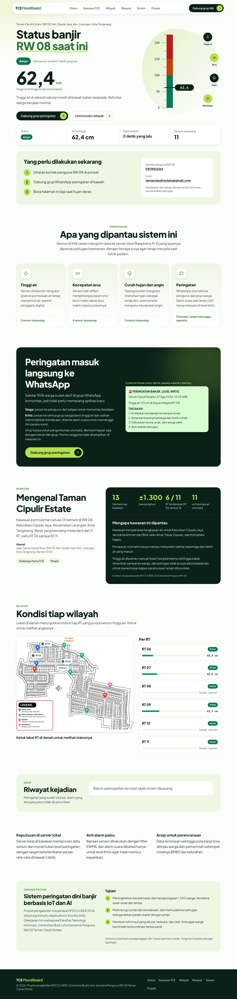
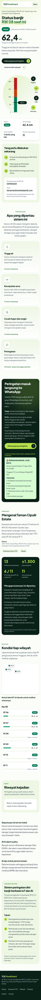
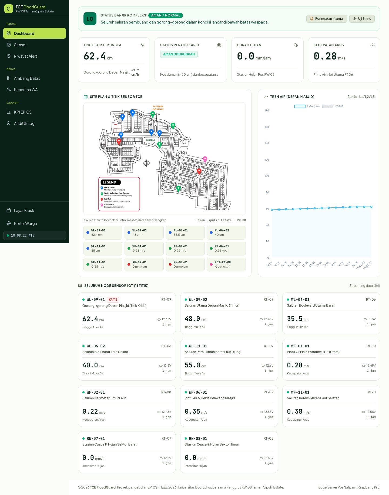
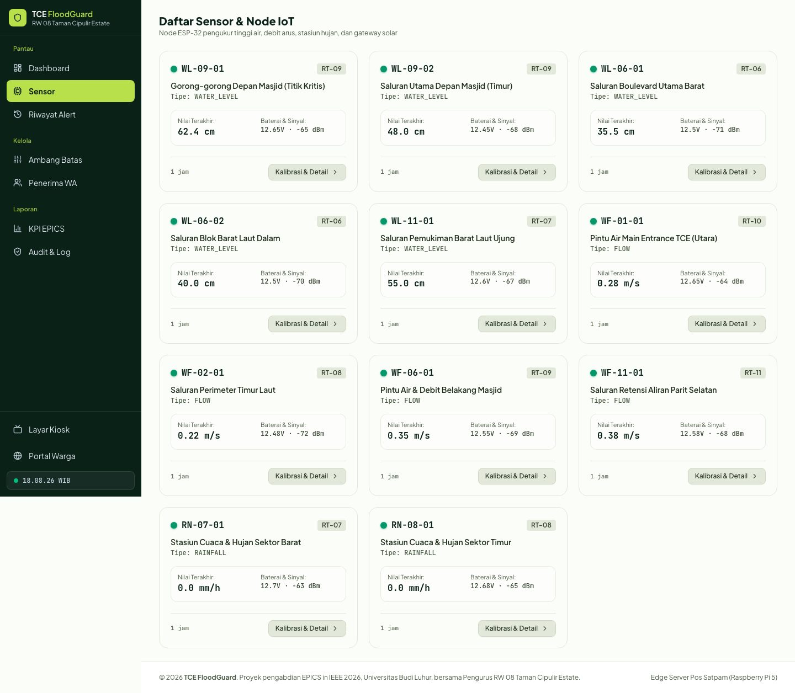
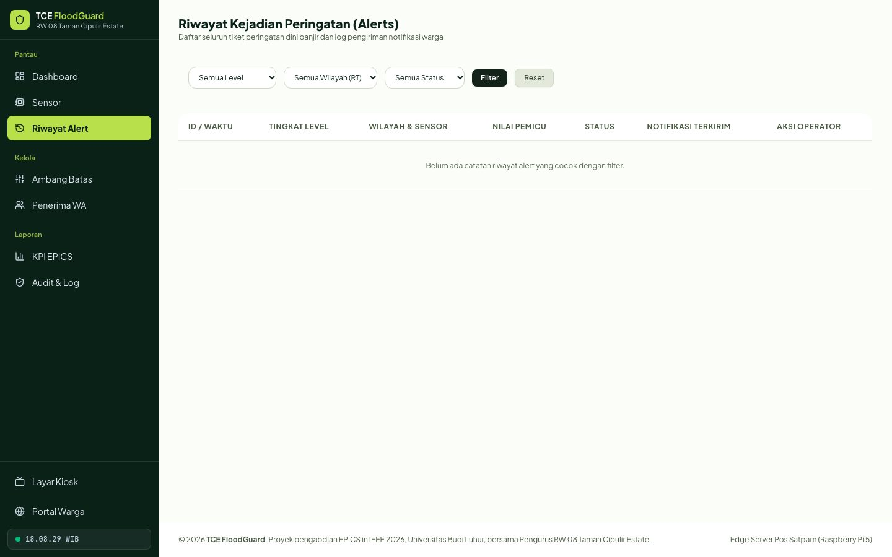
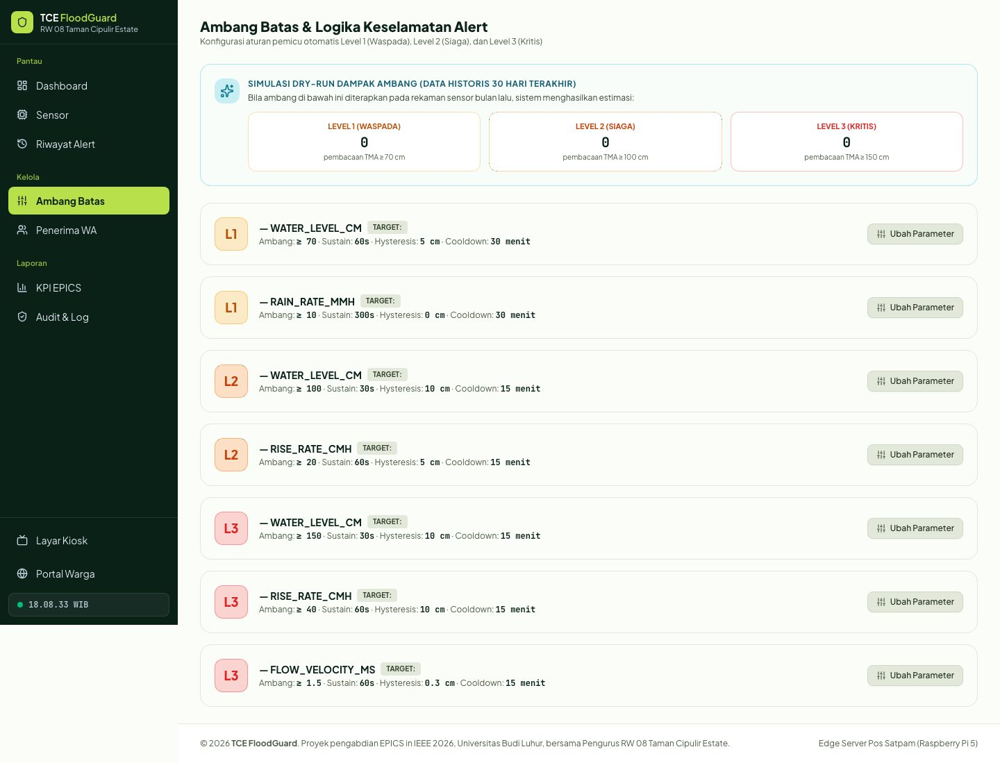
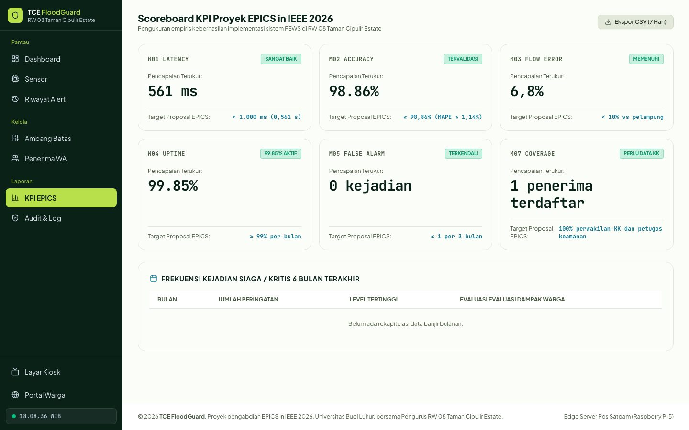
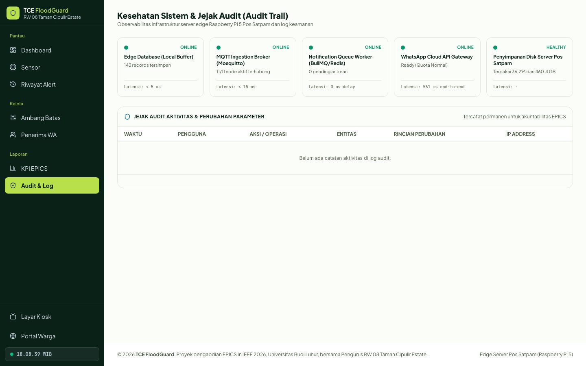
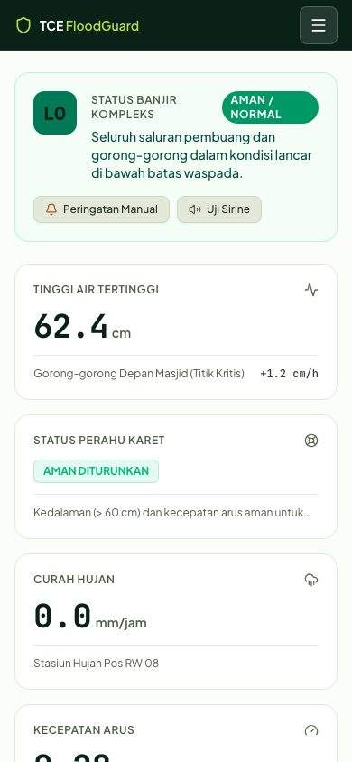

# TCE FloodGuard

Sistem peringatan dini banjir (**Flood Early Warning System**) untuk **Taman Cipulir Estate, RW 08**, Kelurahan Cipadu Jaya, Kecamatan Larangan, Kota Tangerang. Proyek pengabdian **EPICS in IEEE 2026** oleh tim mahasiswa Fakultas Teknologi Informasi Universitas Budi Luhur bersama Pengurus RW 08.

Sensor tinggi air, arus, dan curah hujan mengirim data ke server lokal. Server menentukan level peringatan (Aman, Waspada, Siaga, Kritis), lalu mengabarkan pengurus dan warga lewat WhatsApp, dan menampilkannya di dashboard admin serta landing page publik.

> Panduan untuk anggota tim (install, alur kerja, aturan): **[PANDUAN.md](PANDUAN.md)**

---

## Landing page publik

Alamat `/`. Dibuka warga tanpa login, dirancang mobile-first.

| Desktop | Mobile |
| :-----: | :----: |
|  |  |

Isi halaman: status banjir dan tinggi air tertinggi, penggaris tinggi air, langkah yang perlu dilakukan sesuai level, kondisi tiap RT di denah kawasan, riwayat kejadian, tombol gabung grup WhatsApp peringatan, info kawasan TCE, dan tentang proyek.

Data sensor yang lebih dari 15 menit tidak pernah ditampilkan sebagai "Aman"; halaman menulis "Data belum tersedia".

---

## Dashboard admin

Alamat `/admin`. Dipakai pengurus RW, satgas, dan petugas keamanan.

### Dashboard



Status kompleks, tinggi air, status perahu karet, curah hujan, arus, denah dengan pin tiap sensor (klik pin untuk data lengkap), grafik tren air, dan kartu setiap sensor.

### Sensor, alert, dan ambang

| Daftar sensor | Riwayat alert |
| :-----------: | :-----------: |
|  |  |



### KPI dan kesehatan sistem

| KPI EPICS | Kesehatan sistem dan audit |
| :-------: | :------------------------: |
|  |  |

### Tampilan HP



---

## Fitur utama

- **Alert engine** dengan konfirmasi durasi, hysteresis, dan konfirmasi lebih dari satu sensor untuk mencegah alarm palsu.
- **Notifikasi WhatsApp** lewat gateway Fonnte, memakai antrean dan percobaan ulang, tercatat lengkap dengan latensi.
- **Landing publik** dan **dashboard admin** dengan peta denah kawasan.
- **Simulator data sensor** (`php artisan fews:simulate`) untuk uji tanpa perangkat keras.
- Pencatatan audit, ekspor CSV, dan skor KPI proyek.

## Teknologi

Laravel 13, PHP 8.3+, Tailwind CSS v4, Vite, Leaflet, Chart.js, SQLite (lokal).

## Memulai cepat

```bash
git clone https://github.com/rendikaadji/dashboard_banjir-web.git
cd dashboard_banjir-web
composer run setup      # install, salin .env, key, migrasi, build aset
composer run dev        # server + queue + vite
```

Lalu buka `http://localhost:8000` (landing) dan `http://localhost:8000/admin` (admin). Langkah lengkap, konfigurasi WhatsApp, dan aturan tim ada di [PANDUAN.md](PANDUAN.md).

## Dokumen

| Dokumen | Isi |
| ------- | --- |
| [PANDUAN.md](PANDUAN.md) | Panduan tim: install, alur kerja Git, aturan, pemecahan masalah |
| [docs/PRD.md](docs/PRD.md) | Kebutuhan produk lengkap |
| [docs/DESIGN.md](docs/DESIGN.md) | Arah desain landing dan admin |
| [docs/AI-USAGE-POLICY.md](docs/AI-USAGE-POLICY.md) | Kebijakan penggunaan AI tim |

## Catatan keamanan

`/admin` belum memiliki login. Jangan dibuka ke internet sebelum autentikasi dipasang. File `.env` (berisi token) tidak boleh di-commit.
